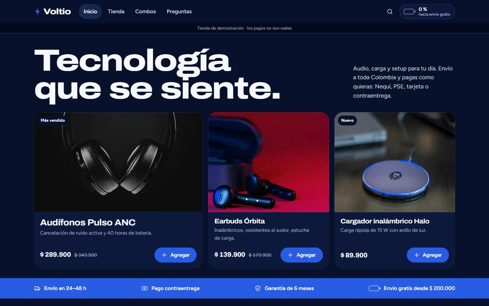
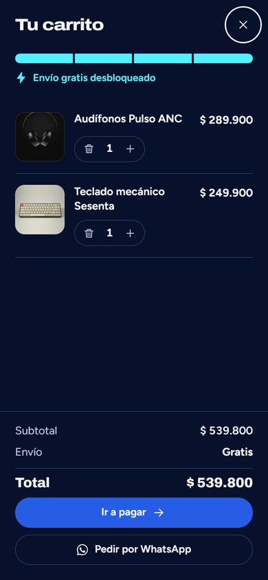

# Voltio · Store Demo

**Live demo: https://kilianvega-dev.github.io/voltio-demo/**

A landing page plus a complete online store for a fictional Colombian tech-accessories shop. It is built mobile-first, because most customers arrive from WhatsApp or Instagram on their phones. The site is in Spanish and prices are in COP.

The store, its products, prices and reviews are fictional, and the checkout is a simulation: no payment is processed and no data leaves the browser.

<p align="center">
  
  
</p>

## Features

- **Landing page:** featured products you can add to the cart straight from the first screen, category index, best sellers, product bundles, reviews and FAQ.
- **Shop:** category filters, accent-insensitive search and sorting by price or rating.
- **Product page:** gallery with a detail view, previous price and discount, specs, the bundle the product belongs to, and related products.
- **Cart drawer:** the cart button is a battery that charges toward the free-shipping threshold. The drawer suggests the cheapest product that unlocks free shipping. The cart is kept in `localStorage` and synced across tabs.
- **Checkout:** delivery form with inline validation, and Colombian payment methods (cash on delivery, Nequi, PSE, card), each with its own fields. It also offers "order through WhatsApp", which sends the whole cart as one pre-filled message.
- **Confirmation page:** order number, delivery steps and a button to send the order by WhatsApp.
- **Accessibility:** keyboard-friendly, native `<dialog>` for the cart, live announcements when you add products, and motion that respects `prefers-reduced-motion`.

## Stack

Plain HTML, CSS and JavaScript, with no framework and no build step. It runs on any static host. All the store content lives in `assets/js/data.js`, so the template can be adapted to another business by editing that one file.

```
index.html, tienda.html, producto.html, checkout.html, confirmacion.html
assets/css/styles.css   design tokens, layout, components
assets/js/data.js       products, bundles, reviews, FAQ, store settings
assets/js/app.js        cart, battery meter, drawer, page rendering, checkout
```

Fonts (Archivo and Figtree) are self-hosted as variable WOFF2 files.

## Credits

Product photos: Unsplash ([Unsplash License](https://unsplash.com/license)), listed in [CREDITS.md](CREDITS.md).

Designed and built by **Kilian Vega**.

## License

MIT
